# Report, lane 78: the blank states of TEXT, MELODY, and INSIGHTS

r1, 2026-11-21, by the cloud lane (Sonnet). Branch `cloud-lane-78`. Brief: `brief-code-lane78-blank-states_r3_2026-11-21.md`. Words: `ratified-blank-state-blurbs_2026-11-19.md`, read in full with its 2026-11-20 corrections.

## 0. Provenance

- **Base.** `ac4bc6d85cc288d90b96e03528f56a49f8b27002` (`origin/Shane`, Dann's close commit), as Dann ruled in this session. Working tree clean at the start. Nothing was committed to or pushed to `Shane` or `main`. No pull request is open.
- **The base question, for the record.** The cloud clone's local `Shane` was `ab67b836`, which was not an ancestor of `origin/Shane` (161 commits on the local side that the remote lacks) and did not hold the brief. The branch was first cut at `ab67b836`, then I stopped and asked. Dann chose `origin/Shane`, and `git checkout -B cloud-lane-78 origin/Shane` put the branch there. The first push used an explicit refspec, because that checkout had set the upstream to `origin/Shane`.
- **Tests that were run on a dev server** used `pnpm dev`, which fetched the OMR models and copied wasm into `static/`. None of those generated files is in the diff.

## 1. What was built

**Step 1, one component.** `components/Paper/BlankState.svelte` draws the squircle for all three pages: `InsightsPane`'s outline (12 px radius, 1 px accent, padding 16 px 26 px, 12 px gap), accent a prop (sage for TEXT, lavender for MELODY, rose for INSIGHTS), roman, left-ranged. Its window is `top`/`bottom` props from each page's own geometry, and it is a grid of `1fr auto 1fr`, so the squircle is the middle row and stays centred whatever NOTES holds in the third. `TITLE_HEADER_GAP` is untouched (still 18, still read by the score's window and position; a test pins it).

**Step 2, the words and the table.** Every string is the companion's or already in the tree (section 3). The state table is built as written; its logic is `markup/blank-notes.ts` (pure, tested row by row). Both panes use `adapted.completeness.formants` as the voice test, and MELODY uses `adapted.generic` and `isPersonal` as the table names. No fourth test was added. The third ask form (voice missing, score present) is in `i18n.ts` as `insights.silence.noVoice` and read by nothing.

**Step 3, the links.** INPUT and VOICE are links. POEM and LYRICS are not. `components/Paper/blank-state.ts` `linkParts` finds each section name by position, case-sensitive and whole-word, once per sentence: « Établissez votre voix dans VOIX » links only « VOIX ». **What replaced `SingerBlock`'s exact-string equality mechanism:** that mechanism and its `withInput` snippet and `.input-link` rule are deleted, and `linkParts` takes its place for every blank page. The two NOTES links on INSIGHTS (`calib.pane.door.insights`, the record door) stay as built.

**The VOICE link reveals the band and does not enter the takeover.** `+page.svelte`'s `openInput` became `openBand(id)` (`leaveThen`, the phone's `drawerRaised`, `sections.reveal`, and the scroll to the head, as `openInput` did), with `openInput` and `openVoiceBand` as one-line wrappers. The id is `BAND_IDS.scoreMarkup`, whose head carries `data-band-head="scoreMarkup"` (confirmed in `Drawer.svelte` and by a desk e2e that finds the head in view). It fit the lines `+page.svelte` had (5532 to 5533), so the stop condition did not arise.

**Step 4, what retires.** `paper.empty`, `paper.empty.mobile`, `profile.emptyState`, `profile.lede`, `profile.provisional.noneMessage`, `insights.method.noScore.none` are gone from the table and read by no source file (a test scans every non-test source file). The directional tails of the two provisional sentences are replaced by the companion's wording. TEXT's device split is gone (`TitlePage` lost its `isMobile` prop, which only the split read). `loading` draws `dict.loading` alone in the squircle, with no ask and no link. `quiet` draws nothing. **No blank state prints** (`display: none` in print on the squircle and its NOTES); the withheld statement on a score page is untouched and a test pins that nothing hides it.

**Step 5, the comments.** Rewritten to the 2026-11-19 ruling: `one-action.ts` (the `emptyTextNotice` block), `MarkupPane.svelte` (the header comment; the CSS comments at the old `:1184-1189`, `:1211-1213`, `:1236-1251` went with the CSS they described, and the one that named `.profile-content` was reworded), `e2e/core-loop.test.ts:45-46` and its French twin. I left the historical sentence in `one-action.ts`'s opening block that quotes the old string as Dann met it on 2026-09-07, because it records a bug and does not contradict the code.

## 2. Decisions I made, for Dann to overrule

All the brief's DESK DEFAULTs were followed. These are mine and the brief did not name them:

1. **Two paragraphs inside the squircle**: the page's blurb, then the ask. The companion gives them as separate items; it does not say whether they are one paragraph.
2. **VOICE is a link inside MELODY's provisional sentence** ("set them in VOICE"), because a section a singer must visit is a link. INSIGHTS' Method line "measured in VOICE" is descriptive and is not linked.
3. **INSIGHTS' blank window ends at `MARGINS.vertical + footHeight + HEADER_GAP`**, mirroring the header gap at the top. MELODY and TEXT use their existing `contentBottom`. The three therefore differ by a few pixels (section 5).
4. **TEXT's squircle sits at its text column** (left 92, right 96), MELODY's and INSIGHTS' at 96 to 96. A 4 px difference at the left edge that I did not force flat.
5. **The apostrophes** in « qu’ils » and "score’s" are the file's typographic ones (U+2019). The companion's text has straight ones. A test pins the typographic form.
6. **`methodLineKey` returns `null`** for no score, no samples, no generic values (the brief's DESK DEFAULT), so `isGenericMethodKey` also accepts `null`.

## 3. The words, and where the tree and companion differ

Verbatim from the companion, EN and FR, pinned in `blank-states.test.ts`: the three blurbs, the three asks, both provisional sentences (singular from the 2026-11-20 17:17 correction). The tree wins for `profile.statusSetPlain`, `profile.statusSetMeasuredSingular`, `profile.statusSetMeasuredPlural`, `insights.method.noScore.samples`, `insights.method.noScore.generic`, unchanged. The three live strings that differ from the companion on purpose were changed to the companion's wording: `insights.silence.noScore` and the tails of the two provisional sentences. No sentence was invented in either language. A test checks that none of the strings the three pages draw holds a directional word (EN or FR), and that the singular and plural provisional sentences name no direction.

## 4. The eight gates

Run from the repository root with pnpm, on a fresh `pnpm install --frozen-lockfile`.

| Gate | Baseline you gave | Measured before | Measured after |
|---|---|---|---|
| phonology | 462 passed (462) | 462 passed (462) | 462 passed (462) |
| dictionary | 248 passed (248) | 248 passed (248) | 248 passed (248) |
| web-check | 0 errors, 12 warnings, 5 files | 0 errors, 12 warnings, 5 files | 0 errors, 12 warnings, 5 files |
| web-test | 6743 passed 1 skipped (6744) with numpy and scipy, 6739 passed 5 skipped (6744) without | **6739 passed 5 skipped (6744)** | **6781 passed 5 skipped (6786)** |
| score-parser | 904 passed 5 skipped (909) | 904 passed 5 skipped (909) | 904 passed 5 skipped (909) |
| blurb | 178 passed (178) | 178 passed (178) | 178 passed (178) |
| integration | 159 passed (159) | 159 passed (159) | 159 passed (159) |
| ratchets | OK | OK | OK |

**Which web-test figure I measured: the without-scipy figure.** `numpy` imports in this sandbox and `scipy` does not, so the 5 skipped are the scipy-dependent ones. The with-scipy figure was not measured. After the lane the same 5 skip, and the total rose by 42 tests.

## 5. The line-count ratchets

The two panes sit at their ceilings, so this is the table you asked for. "Ceiling" is `scripts/ratchets.json` before my edit.

| File | Before | After | Ceiling before | Ceiling after |
|---|---|---|---|---|
| `markup/MarkupPane.svelte` | 1349 | 1234 | 1349 | 1234 |
| `insights/InsightsPane.svelte` | 677 | 674 | 677 | 674 |
| `routes/+page.svelte` | 5532 | 5533 | 5534 | 5533 |

I lowered those three ceilings, which the file says to do when a file shrinks. `+page.svelte` grew by one line (`openInput` became `openBand` plus a one-line pair of wrappers) and stayed under its ceiling.

Other touched files, none ratcheted: `Paper.svelte` 264 to 267, `TitlePage.svelte` 214 to 202, `SingerBlock.svelte` 630 to 627, `singer-blocks.ts` 396 to 397, `identity.ts` 75 to 75, `links.ts` 17 to 20, `one-action.ts` 173 to 171, `i18n.ts` (exempt) 2743 to 2727. New files: `BlankState.svelte` 156, `blank-state.ts` 70, `blank-notes.ts` 58, and three test files (161, 54, 57).

## 6. The twelve screens

Rendered with the live dev server in Chromium, no score loaded, no voice saved (so MELODY and INSIGHTS show the both-missing ask), at 390 by 667 (device scale 2) and 1024 by 1366 (device scale 2; I chose the height so the whole sheet shows, since the brief gave only a width). Files are in `report-code-lane78_r1_2026-11-21/`.

| | 390 by 667, English | 390 by 667, French | 1024 wide, English | 1024 wide, French |
|---|---|---|---|---|
| TEXT | 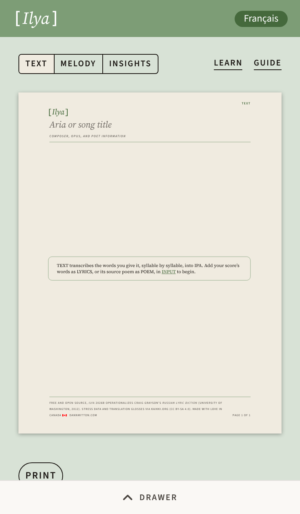 | 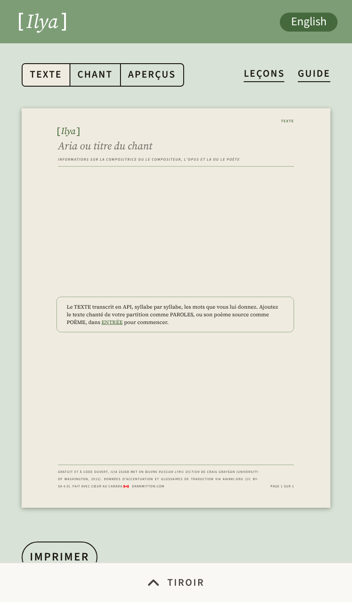 | 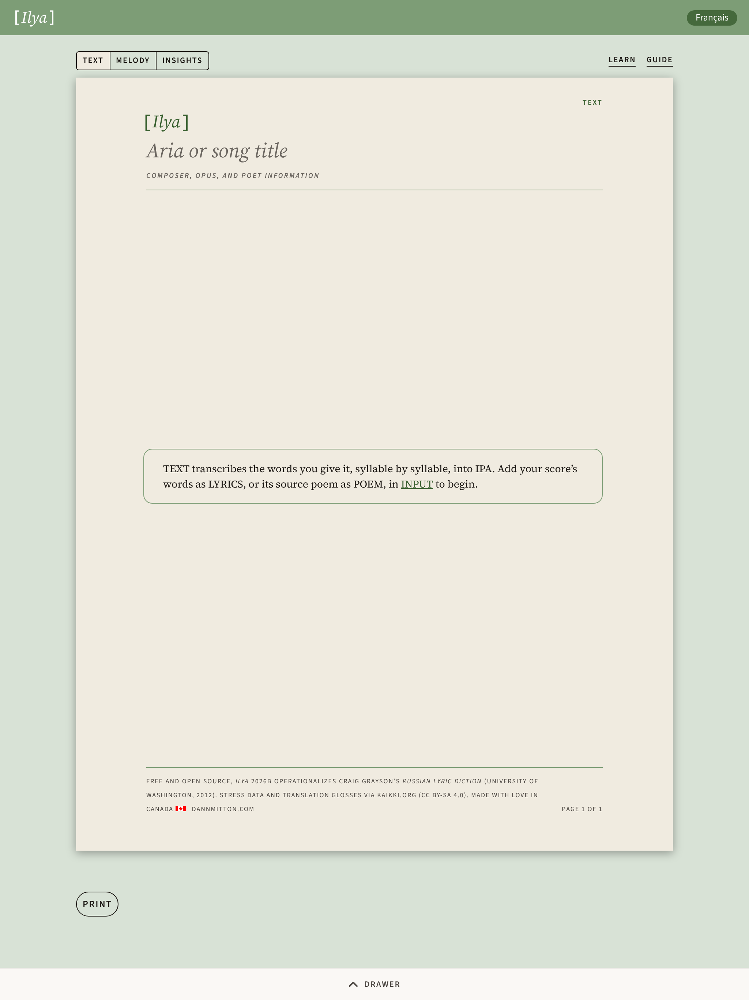 | 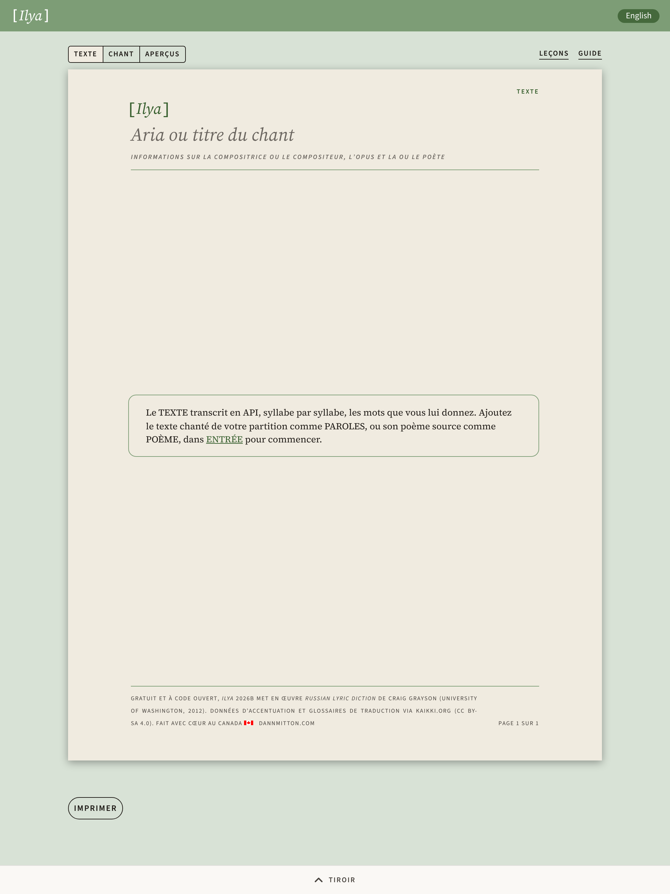 |
| MELODY | 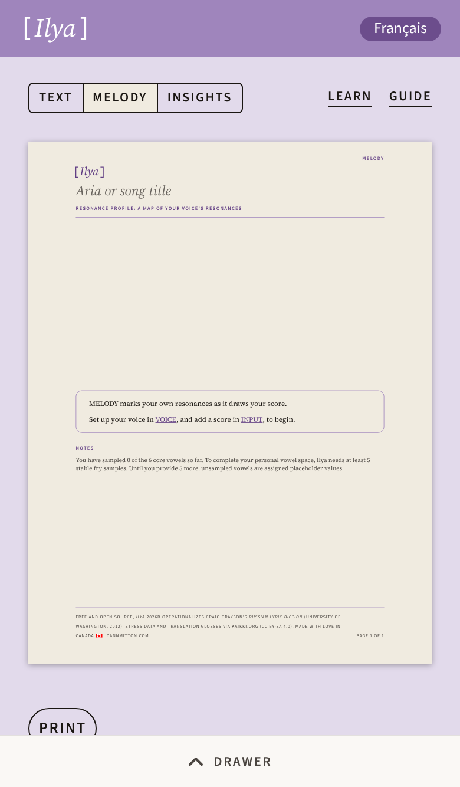 | 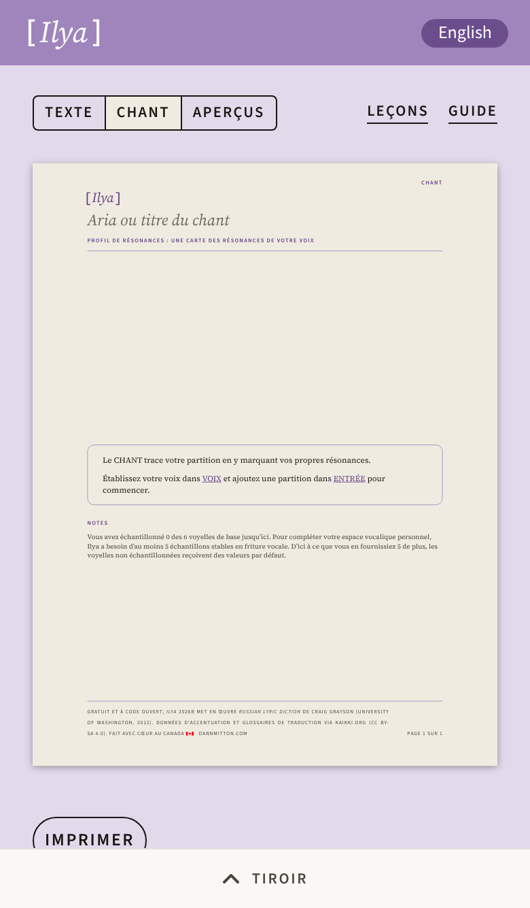 | 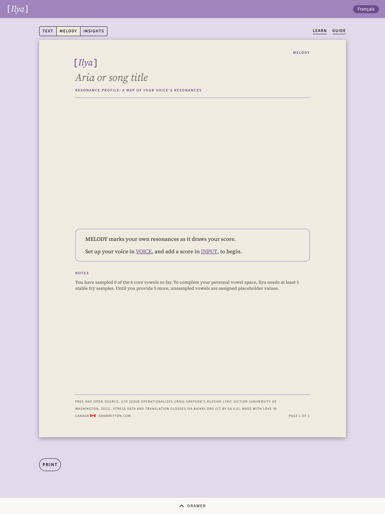 | 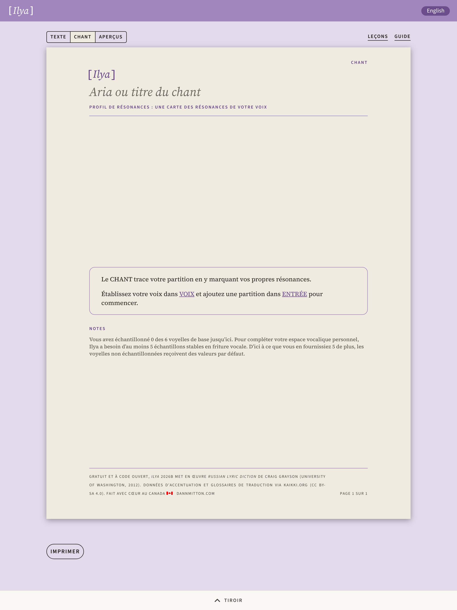 |
| INSIGHTS | 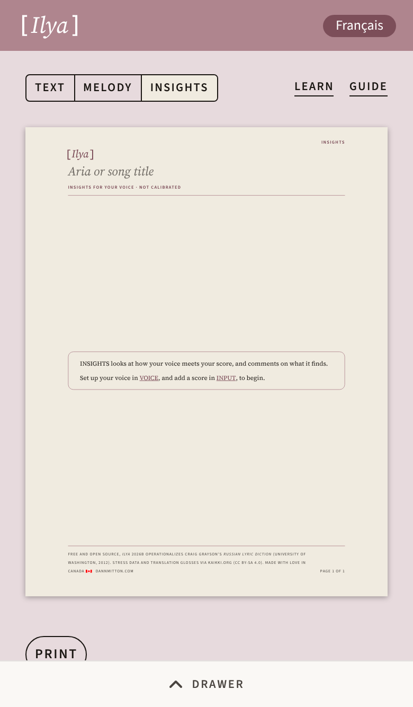 | 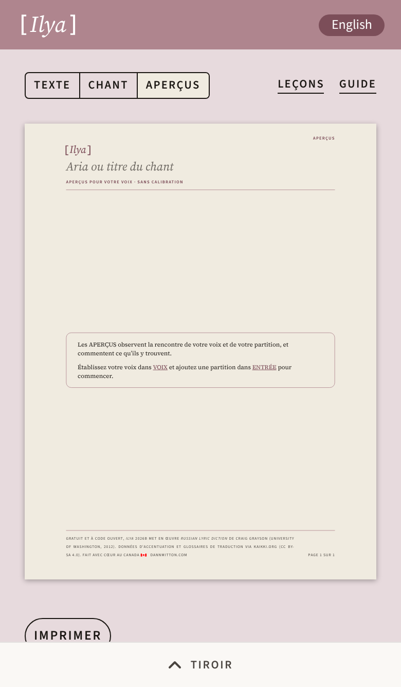 | 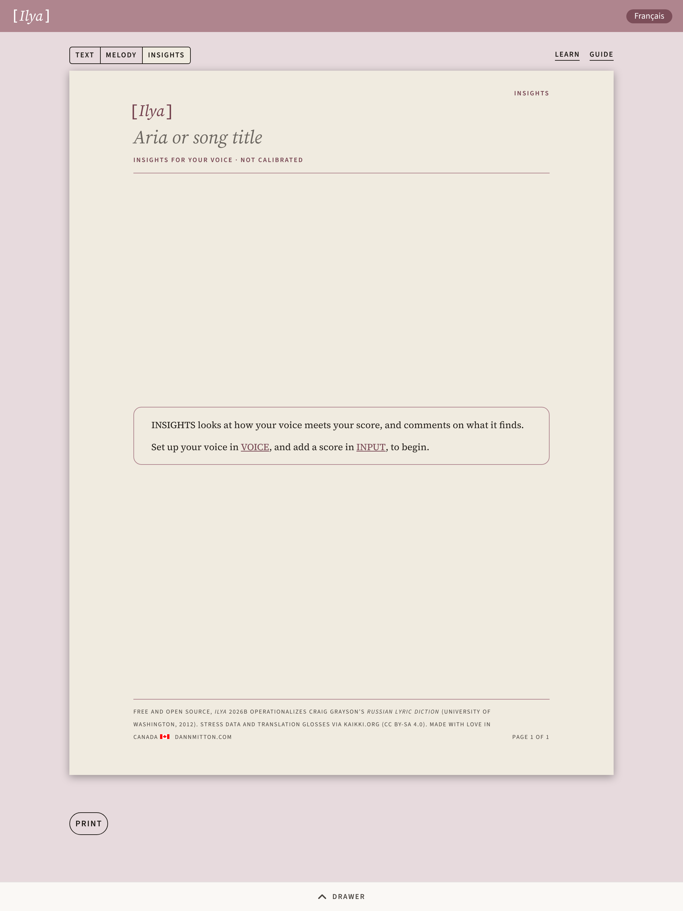 | 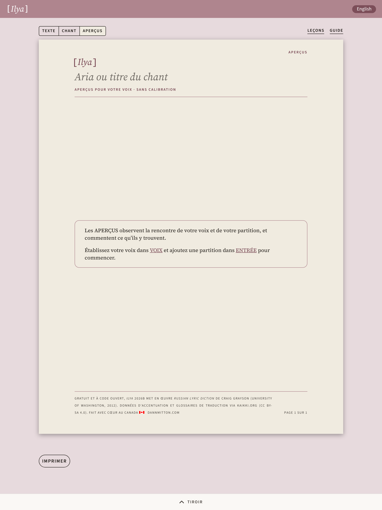 |

Eight more (`notes-*.png`) show MELODY and INSIGHTS with a saved bass voice of six sung vowels, so the squircle asks for the score and NOTES sits under it.

**Where each squircle's midpoint falls.** Measured in the live render (`measurements.json`), in sheet pixels on the 816 by 1056 letter sheet. The window is the title rule's bottom edge to the footer hairline's top edge.

| Page | Title rule bottom | Footer rule top | Window midpoint | Squircle midpoint | Offset |
|---|---|---|---|---|---|
| TEXT | 154 | 942 | 548 | 545 | 3 px above |
| MELODY | 154 | 942 | 548 | 546 | 2 px above |
| INSIGHTS | 154 | 942 | 548 | 548 | 0 |

**The three headers do not differ in height in the no-score state**: the rule falls at 154 on all three. The three midpoints differ by up to 3 px (about 0.3 percent of the sheet), because each page's window is its own (decision 3). I did not force a common midpoint, as step 1 says. Offsets and squircle sizes were the same at 390 and at 1024, and in both languages (the squircle's height changes with the language, its midpoint does not).

## 7. The tests this lane broke, moved, retired, and added

None was deleted to make a number pass. Each broken one is moved or retired as named, with the reason in a comment.

- `insights/ratified-lines.test.ts`: the `insights.silence.noScore` pins move to the ratified ask; the `insights.method.noScore.none` pins are retired, citing the companion's table.
- `stand-in-borrowing.test.ts`: the "`.none` is still reachable" case now says it is retired and the key is `null`.
- `insights/identity.test.ts`: the three `.none` assertions become `toBeNull()`; one `!` for the new return type.
- `insights/links.test.ts`: the equality mechanism's three cases are replaced by three that read `BlankState` in both languages; the no-score blocks case is now the notes block alone or nothing.
- `markup/profile-status.test.ts` (**also changed by lane 76; kept to two assertions**): the pane's call is now pinned in `melodyNotes` and `blank-notes.ts`, and the singular provisional split reads the new wording.
- `e2e/melody-no-score-count.test.ts` (**also changed by lane 76; kept to two locators and a comment**): `.profile-status` becomes `[data-blank-notes] .notes-line`.
- `e2e/core-loop.test.ts` (:45-46 and :235, English and French), `e2e/singer-paths.test.ts` (:189 and the language-toggle case at :98): read the squircle.
- **Found by running the Playwright suite, not on the brief's list**: `e2e/insights-no-score.test.ts` and `e2e/insights-links.test.ts` (read the retired INSIGHTS sentence; the print case now asserts the squircle does not print), `e2e-phone/insights-links.test.ts` (the INPUT link selector), and a shared helper change: `e2e/helpers.ts` `expandStation`, `e2e/voice-links.test.ts`, `e2e/voice-pane.test.ts`, `e2e-phone/voice-stations.test.ts` each looked up a button named "Voice" or "Input" page-wide, and the new links share those names. They now exclude `[data-link]`.
- `i18n-index.test.ts`: the index lines moved (`insights.` 193 to 195, `paper.` 4 to 3, `profile.` 35 to 33) and the total 1,348 to 1,347, as predicted.
- **Added**: `components/Paper/blank-state.test.ts` (the link matcher, 9 cases), `markup/blank-notes.test.ts` (the state table, 7 cases), `components/Paper/blank-states.test.ts` (26 cases: the strings verbatim, the retired keys absent and unread, no directional word, one squircle per page, the geometry and `TITLE_HEADER_GAP`, print, the VOICE wiring, loading and quiet). One new desk e2e covers the VOICE link end to end (saved voice, no type, nothing sampled: the VOICE band opens, its head is in view, no takeover).

## 8. The Playwright suite

372 tests, both projects, in this sandbox: **365 passed, 5 failed, 2 skipped.** The five failures are not this lane's, with this much established: the four phone failures (`input-views.test.ts:134`, `phrase-ends.test.ts:26`, `relining.test.ts:70`, `relining.test.ts:95`) fail identically on the base commit `ac4bc6d8` with my changes stashed; they read Input and Poem copy and line counts, not a blank state. The fifth, `loupe-header.test.ts:47` (a drag moves the card by 30 px, not 40), failed every run with my changes (eight) and also failed 3 of 3 runs on the base, after passing once on the base earlier. A step-by-step trace of the drag gave the same card positions on both trees. I call it unstable in this sandbox and do not attribute it to the lane, but see section 9.

## 9. WHAT YOU COULD NOT ESTABLISH

NOT ESTABLISHED beats a complete invented answer.

1. **Whether `loupe-header.test.ts:47` is flaky on the base or only usually fails here.** One base run passed, then three failed. I could not find a cause. Instrument: eight runs with my changes, four on the base, and a mouse-step trace that agreed on both. It needs a run on a machine where the file is known to be green.
2. **The four phone failures' cause.** I showed they exist on the base. I did not look into why.
3. **The with-scipy web-test figure.** `scipy` is not installed here and I did not install it. I measured the without figure, 6739 before and 6781 after.
4. **MELODY's NOTES with a provisional vowel, drawn.** The unit tests cover the runs (glyph, informal name, the VOICE link, singular and plural, English and French), but both of my saved voices had no provisional vowel, so I have no picture of a provisional sentence, and none of the "sung, not yet complete" row. Instrument: `blank-notes.test.ts` only.
5. **Whether MELODY's and INSIGHTS' old blank content printed.** By source, both did: `MarkupPane`'s print block never hid `.profile-content`, and `SingerBlock`'s print block never hid a `silence` line. TEXT's `.empty-directive` was hidden in print. If that is right, "no blank state prints" is a change for MELODY and INSIGHTS. I did not render the old print. For the new tree I checked print by browser only on INSIGHTS (an e2e); for TEXT and MELODY, by a source test of the shared component's rule.
6. **The VOICE link on a phone.** The phone step (`drawerRaised`) is mirrored from `openInput` by source and pinned by a test, and the phone's INPUT link test passes, but there is no phone test of the VOICE link.
7. **Safari and a real iPhone.** Everything was seen in Chromium. Dann's report of 2026-11-20 was an iPhone.
8. **The pictures predate one edit.** I fixed an empty NOTES wrapper on INSIGHTS (a `underneath` prop) after taking them. It does not change the squircle's position (the wrapper was an empty third grid row) and the suite ran after it, but the pictures themselves were not retaken.
9. **A header that differs in height.** All three were equal here because none held a long title, composer, or note. With a long identity line or note on INSIGHTS they could differ, and I did not test that.
